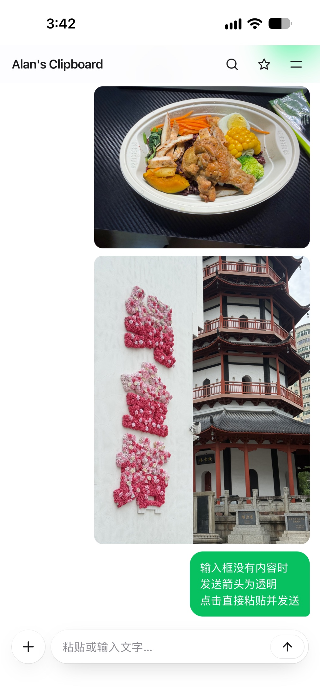
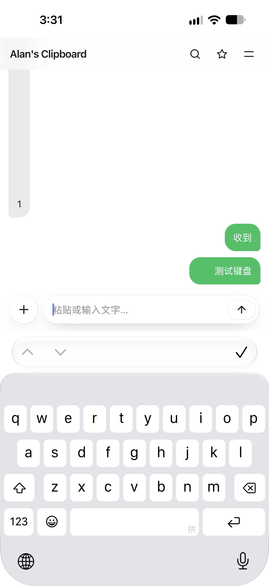
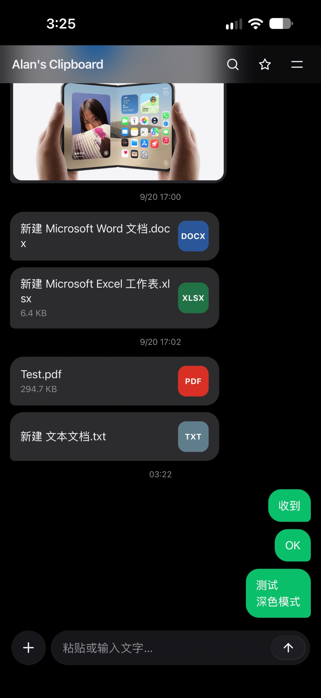
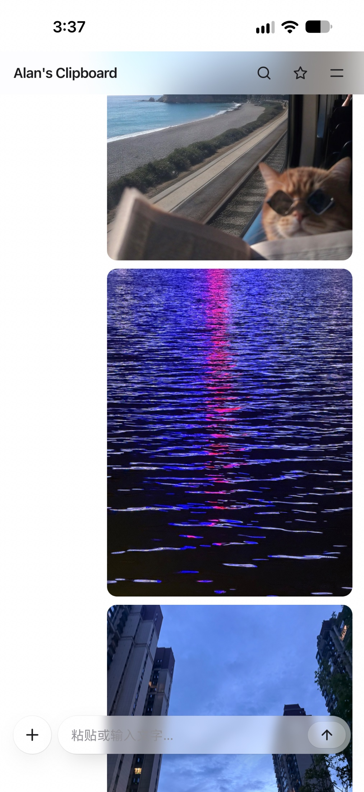
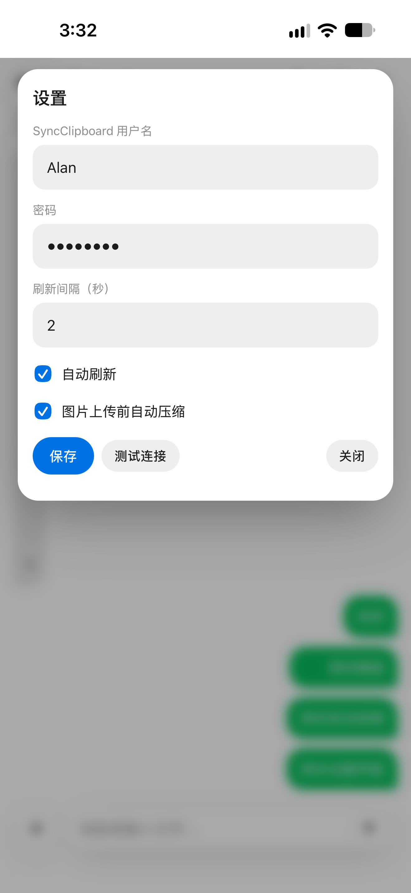

# clipweb

给 [SyncClipboard](https://github.com/jerick/SyncClipboard) 套的浏览器界面 —— 手机打开网页就能和电脑互传剪贴板，不依赖 iOS 快捷指令。

## 功能

- **剪贴板同步**：手机上打开网页，电脑上复制的内容几秒后自动出现在手机里；手机发出去的内容同样同步到电脑。
- **文件传输**：支持图片、文档（pdf/word/excel/ics 等）双向传输，文件气泡显示文件名、大小和彩色扩展名图标。
- **聊天式界面**：左灰气泡 = 电脑来的，右绿气泡 = 自己发的（像聊天气泡一样看谁发的），历史无限回看。
- **移动端深度适配**：iOS 毛玻璃观感、键盘弹层、"加到主屏幕"独立窗口、原生长按菜单（图片可存储到照片）。
- **轻量前端**：无框架、无构建、无 CDN，改完刷新即生效；部署需要 SyncClipboard 后端及 nginx 代理。

## 界面

**主界面（浅色 · 磨砂顶栏 + 聊天气泡 + 玻璃底栏）**



<details>
<summary>键盘弹起 · 输入交互</summary>


</details>

<details>
<summary>深色模式 · 文件卡片</summary>


</details>

<details>
<summary>滚动时的毛玻璃效果</summary>


</details>

<details>
<summary>设置面板</summary>


</details>

## 目录结构

```
├── html/
│   ├── index.html         # 页面本体：全部 UI + CSS
│   ├── app.js             # 全部逻辑：轮询、认证、渲染、缓存、贴底、菜单
│   └── assets/             # 浏览器和 iOS 主屏图标
├── nginx.conf             # 部署关键：静态页 + API 反代，WebDAV 兼容
├── deploy/
│   ├── config.example.json  # SyncClipboard 服务端配置示例（脱敏）
│   ├── WINDOWS.md           # Windows 电脑部署及排障说明
│   ├── windows.ps1          # Windows 安装、启动、停止、登录启动管理
│   ├── start-hidden.vbs     # 登录时隐藏窗口启动
│   └── nginx.windows.conf   # Windows 专用静态页及 API 代理配置
├── docs/
│   └── img/                 # README 界面截图
└── Dockerfile             # clipweb 容器构建（nginx:alpine）
```

## 部署

支持两种部署方式，二选一：

- **Windows 电脑当服务器**：直接使用 SyncClipboard 客户端的内置服务器，不需要 NAS 或 Docker。见 [Windows 部署完整说明](deploy/WINDOWS.md)。
- **Linux / NAS**：使用下面的 Docker host 网络方式；不能将这些命令原样用于普通 Windows Docker 网络。

### Windows 快速开始

在 SyncClipboard 中开启内置服务器，端口设为 `5033`，配置服务器账号密码。在下载或克隆后的仓库根目录打开 PowerShell：

```powershell
powershell -NoProfile -ExecutionPolicy Bypass -File .\deploy\windows.ps1 -Action Start
powershell -NoProfile -ExecutionPolicy Bypass -File .\deploy\windows.ps1 -Action EnableStartup
```

电脑打开 `http://localhost:5034/`，局域网设备打开 `http://电脑局域网IP:5034/`，在网页设置里输入内置服务器的账号密码。首次启动会从 nginx.org 下载 nginx 到本地 `.runtime/`，该目录不提交到 Git。

网页代理和 SyncClipboard **独立运行**；第二条命令只设置网页在当前用户登录 Windows 后后台启动，不会启动 SyncClipboard。请另行启用 SyncClipboard 自启动。仅限可信局域网使用；HTTP 不加密账号和内容，浏览器直接读取剪贴板可能要求 HTTPS。

### Linux / NAS（Docker）

### 1. SyncClipboard 服务端

宿主机上跑 [SyncClipboard](https://github.com/jerick/SyncClipboard) 服务端，监听 `127.0.0.1:5033`（配置参考 `deploy/config.example.json`，改账号密码）。

### 2. clipweb 容器

```bash
docker build -t clipweb .
docker run -d --name clipweb --restart unless-stopped --net=host clipweb
```

clipweb 用 host 网络，监听 `5034`。网页和 API 同源，浏览器访问 `http://<nas-ip>:5034/` 即可。

### 3. 反代规则（可选，HTTPS）

宿主机上再套一层 nginx/DSM 反代，把 HTTPS 指到 `127.0.0.1:5034`。Windows 客户端走 WebDAV 协议，nginx.conf 里已处理 `PROPFIND /` 的兼容（见文件内注释）。

## License

MIT
